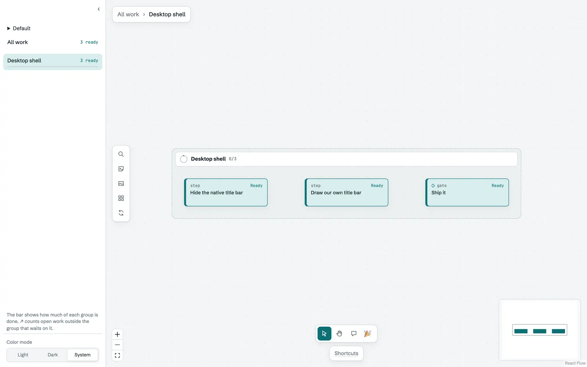
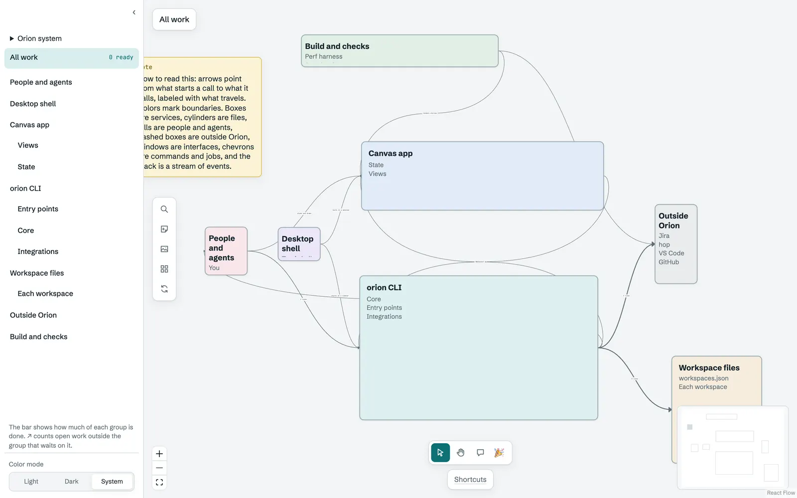
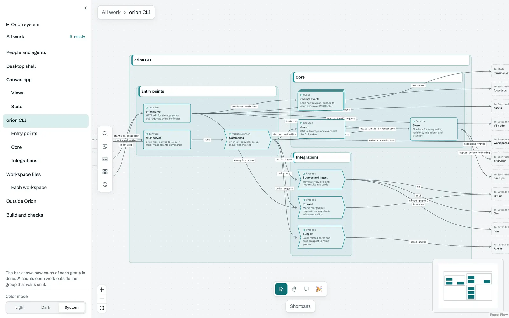
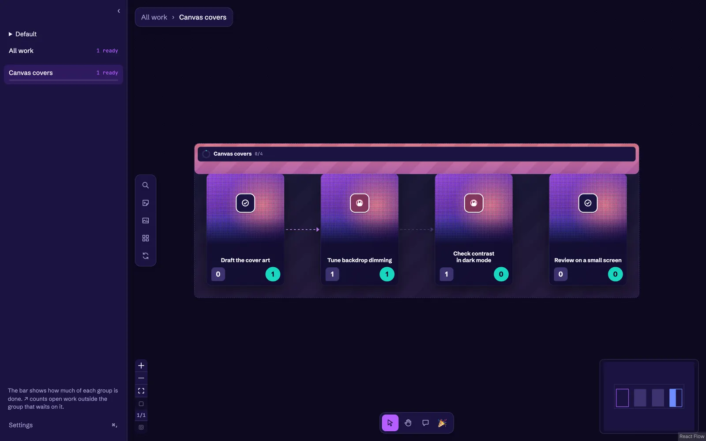
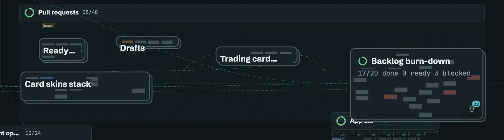
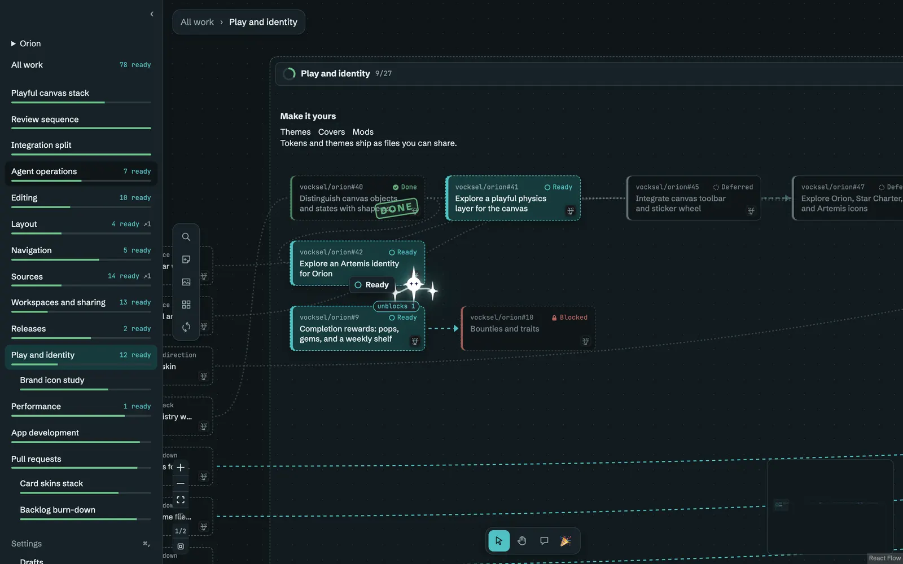
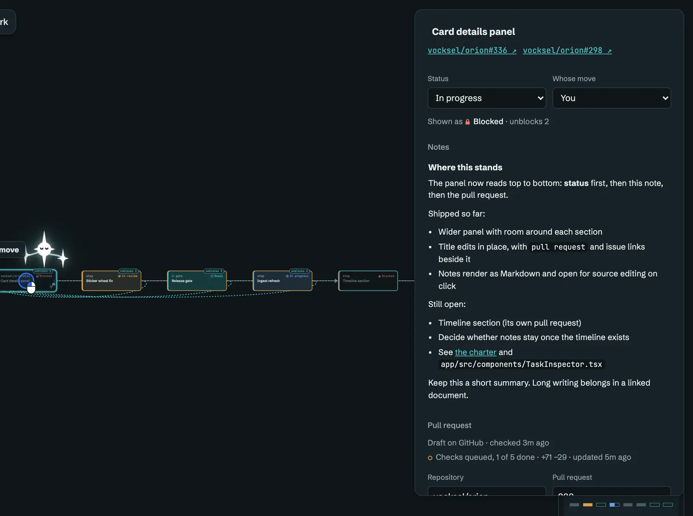

# Canvas and layout

The canvas places groups and cards, draws the links between them, and decides how much detail to show at each zoom. This page follows the layout explorations, the desktop window frame, system diagrams, covers, and the panels that show a card's details.

## October 5, 2026: Skyscraper gravity

The [gravity exploration](https://github.com/vocksel/orion/pull/16) previewed an opt-in layout in which top-level groups settle to the left, against the foundation or another group, like a skyline. Dragging a group's header changes the stack. The preview keeps its positions in memory and restores the previous view when it is left. The exploration stayed open.

## October 6, 2026: Blockers as gateways

The [blocker exploration](https://github.com/vocksel/orion/pull/32) replaced the red Blocked label on waiting cards with a gateway. Each card that waits on work that can start now gets a blocker standing in front of it, and arrows from that open work flow into the gateway. The idea was to show what stands in front of a card, not only that it is blocked. Cards blocked by hand keep the label. Cards further down a chain fade the more rounds of open work stand before them. The exploration stayed open.

## October 9, 2026: Weave

The [Weave mode](https://github.com/vocksel/orion/pull/150) would be an alternative to the layered layout. It keeps the current arrangement and moves cards the shortest way off any line that runs through them, leaving a 16 px gap. The exploration adds a toggle beside Tidy that switches between Layered, the existing ELK layout, and Weave, and the choice is remembered per browser. Each round, Weave tries a few moves for the most crowded cards and keeps the one that lowers the cost most. It stops when no move helps.

This replaces an [earlier Weave attempt](https://github.com/vocksel/orion/pull/38), which was closed on October 9. The new one is still open.

## October 10, 2026: Window chrome

The [window chrome](https://github.com/vocksel/orion/pull/198) drops the native title bar in the desktop app and draws Orion's own, as Claude and Chrome do. On macOS the traffic lights sit in the sidebar header, or beside the breadcrumbs when the sidebar is hidden. On Windows and Linux, minimize, maximize, and close sit at the top right. Canvas actions moved from the breadcrumb panel into a vertical toolbar on the canvas's left edge, styled like the tool switcher. The breadcrumbs stay in a slim floating panel.

## October 10, 2026: System diagrams

The [system diagrams](https://github.com/vocksel/orion/pull/201) add what work cards lacked: components for services, apps, files, and outside tools, joined by links that say what flows along them. Components have no status and do not count as work. There are seven shapes, each with its own outline: service, store, actor, external, interface, process, and queue. Groups and components take a color from a fixed palette, and a group's color tints its frame.

The canvas already zooms from boxes into groups, so a diagram reads from the outside in. Opening a group shows the parts inside it, and the components outside it that it talks to appear as ghosts.

## October 11, 2026: Covers and backgrounds

The [covers and backgrounds](https://github.com/vocksel/orion/pull/264) give a canvas or a group an image across the top, and a background of a hex color, a color token, or an image. An image background is dimmed toward the canvas color so cards and links stay readable. Clearing either returns to the stock look. Covers are media assets stored in the canvas's data folder and referenced by id, so the canvas document holds no image data.

The charter's [Make it yours](/development/charter#make-it-yours) section asks for nearly every visible property to be themeable, and covers are one piece of that.

## October 13, 2026: Folded previews, Markdown headers, and card details

The [folded previews](https://github.com/vocksel/orion/pull/339) show a faded preview of what is inside a folded group, behind its label. The previews fade to 35% opacity, show at most 80 items nearest first, and never take pointer events, so the group's label and stats stay readable.

The [Markdown header](https://github.com/vocksel/orion/pull/347) gives a canvas or group a header written in Markdown, with a small set of HTML tags for layout. A group's header is reserved in its layout, so the cards under it move down to make room, and the header hides on a collapsed group or below 0.8 zoom. A canvas header sits above the top level and never covers a card.

The [card details panel](https://github.com/vocksel/orion/pull/342) is wider, and its sections read from most to least important: the title with its links, status and whose move, notes, the pull request, and then relationships. The title edits in place, and notes render as Markdown and open for source editing on click.

The [near-view drawing](https://github.com/vocksel/orion/pull/345) draws only the card bodies near the view, nearest the center first, so a large canvas stays responsive. Cards keep their places and their links while they are off screen.
