# Card identity

This study asks how a card says what it is when the canvas is zoomed out to 0.33. It ran as two rounds of HTML galleries in October 2026, each card drawn in every role and state, then shrunk to canvas zoom and checked in grayscale, under color-vision filters, and blurred. Each option has a short ID, and every option was starred, crossed, or left alone. Stars carried a direction into the next round; crosses dropped it.

It's a study. Nothing here has shipped, and the open questions are listed at the end. The [sources](#sources) open both galleries.

## The problem

A trading card is 198 by 285 canvas units, so at 0.33 it's about 65 by 94 screen pixels. Today's card uses one silhouette for every kind and tints its art by group, so the kind lives in a tile about 15 pixels wide and the Done stamp is the loudest mark on the board. A placeholder differs from a step only by a thin inset dash, and a card from Jira looks the same as one from GitHub.

The galleries test whether someone can, at 0.33:

- Find every gate.
- Tell an issue from a pull request.
- Spot an unfinished placeholder, and never mistake one for Done.
- Tell Done, deferred, and blocked apart.
- Do all of that in grayscale.

The roles cover GitHub pull requests and issues, a Jira issue, a Figma reference, native steps, expected-work placeholders, three kinds of gate (milestone, sign-off, and physical), questions, decisions, and references. Following the charter's one meaning per mark, kind, source, state, and group membership each get their own mark, and each can be swapped on its own.

## Round 1: twelve directions

Round 1 drew twelve directions for the card face, from today's card to paper slips. The verdict column is the read after checking every direction at 0.33 in normal vision, grayscale, deuteranopia, and blur.

| ID  | Direction             | Idea                                                                                                   | At 0.33 | Call    |
| --- | --------------------- | ------------------------------------------------------------------------------------------------------ | ------- | ------- |
| Now | Today's trading card  | Group-tinted dithered art, a small kind tile, and the title over a scrim.                              | Fails   | Crossed |
| A   | Flowchart silhouettes | The outline is the kind: arrow PR, ticket issue, gem gate, speech-bubble question, document reference. | Holds   | Starred |
| B   | Suit band             | One rectangle, with a band across the top in the kind's color.                                         | Partly  | Crossed |
| C   | Glyph poster          | The kind's glyph, drawn huge, is the art.                                                              | Holds   | Crossed |
| D   | Texture suits         | Kind is a pattern: stripes for PRs, dots for issues, chevrons for gates.                               | Partly  |         |
| E   | Arch tops             | Only the top edge changes: a notch for PRs, a round arch for issues, a pointed arch for gates.         | Partly  |         |
| F   | Landscape tiles       | Wide, short cards with a kind block on the left.                                                       | Partly  |         |
| G   | Board-game pieces     | Kind changes the piece: octagon gates, round question and decision tokens, small reference slips.      | Holds   | Starred |
| H   | Book spine            | A colored spine down the left edge carries the kind.                                                   | Fails   | Crossed |
| I   | Pixel sprites         | A sprite per kind over dithered art, drawn on the grid it's shown at.                                  | Holds   | Starred |
| J   | Constellations        | A night sky per card, with the kind's glyph traced as a constellation.                                 | Partly  | Starred |
| L   | Paper slips           | Light paper cards on the dark canvas, inked in the kind's color.                                       | Fails   | Crossed |

A's issue ticket and its Jira variant were crossed on their own, so round 2 needed a new outline for issues.

<div class="gallery">
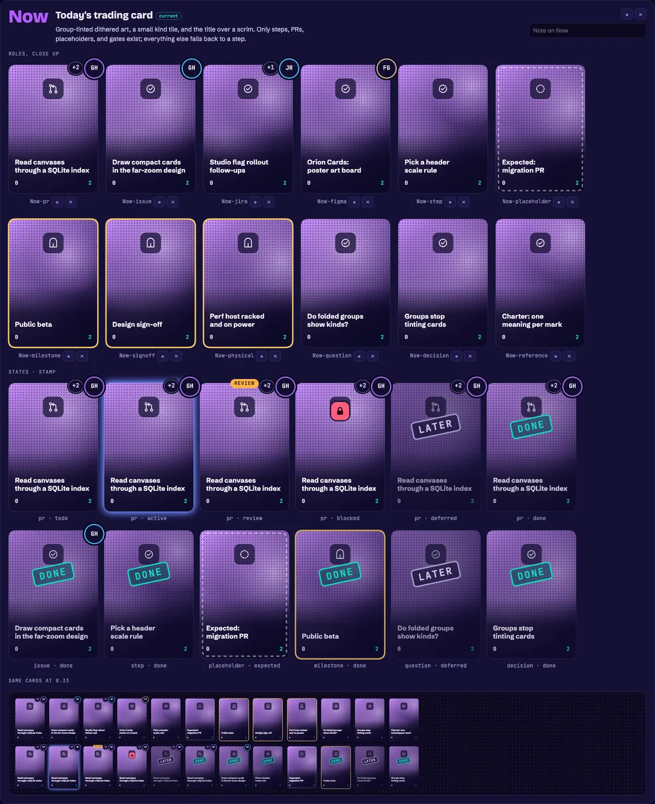
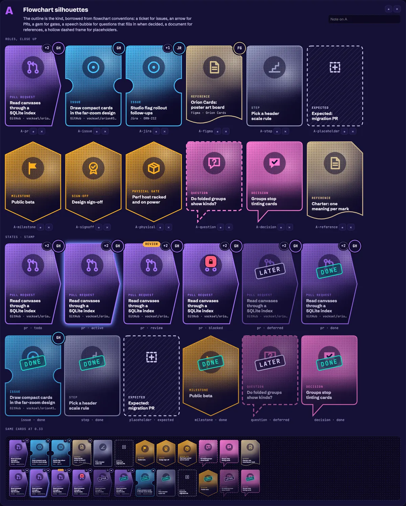
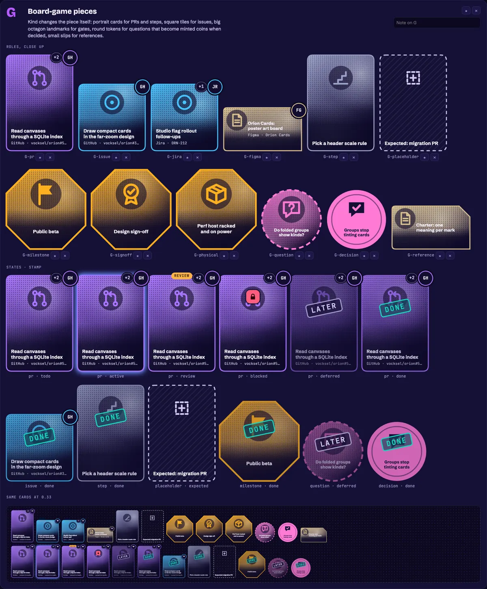
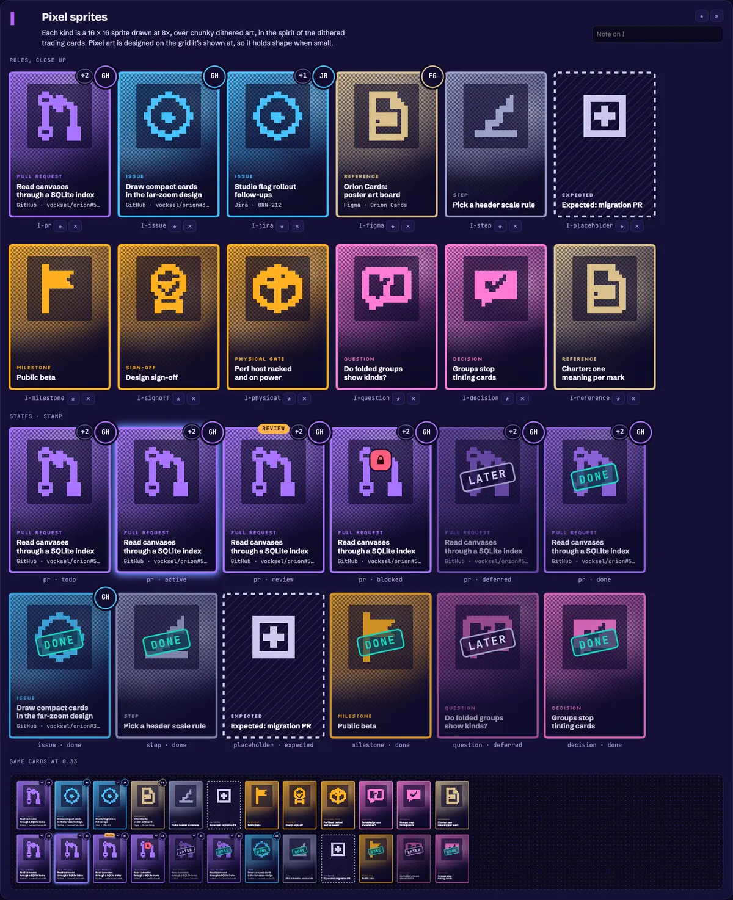
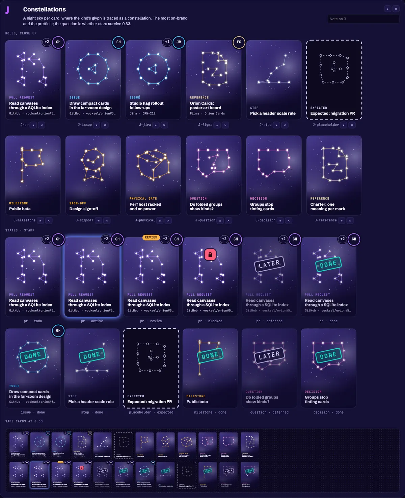
</div>

What held at distance:

- **Shape carries kind.** Silhouettes (A, G, E) and big glyphs (C, I) survive grayscale and blur. G scans fastest, since size and outline both change, but mixed footprints fight grid layout.
- **Color can't carry kind alone.** PR violet and issue blue collapse under deuteranopia, and reference tan sits next to gate amber. Color can back up a shape, never replace it.
- **Constellations are the prettiest up close** and legible at 0.33 on a sharp screen, but blur turns the stars to haze. They need a stronger silhouette underneath.
- **Group tints are a big reason kinds blur together today.** Dropping them frees color for kind.

### State, source, and groups

The same galleries swapped how state, source, and group are drawn, on any direction.

| ID  | Option          | Idea                                                                                   | Call    |
| --- | --------------- | -------------------------------------------------------------------------------------- | ------- |
| S1  | Stamp           | Today: a tilted DONE stamp, a lock for blocked, and fading for deferred.               |         |
| S2  | Corner badge    | Finished and parked cards dim; a corner badge says which.                              |         |
| S3  | Lights out      | Done work goes dark, so whatever is still lit is what's left.                          |         |
| S4  | Face down       | Done cards flip to a shared card back.                                                 | Crossed |
| S5  | Band            | A full-width band across the middle: DONE, LATER, or striped BLOCKED.                  | Starred |
| S6  | Sink            | Done cards shrink and fade into the board, deferred ones tilt away, blocked ones lift. | Starred |
| S7  | Edge bar        | A status bar on every card's bottom edge.                                              |         |
| K1  | Corner coin     | A round coin on the top-right edge with the source's monogram.                         |         |
| K2  | Folder tab      | A tab above the top edge, colored by source.                                           | Crossed |
| K3  | Watermark       | A huge faint monogram behind the art.                                                  | Crossed |
| K4  | Foot strip      | A strip under the card with the source and ref.                                        | Crossed |
| K5  | Source frame    | The outline color belongs to the source.                                               | Crossed |
| K6  | Close-up only   | No mark at distance; the ref line names the source up close.                           |         |
| K7  | Ink coin        | The coin drawn like the kind tile, in the card's own edge color.                       |         |
| K8  | Notch           | The coin as a hole punched in the corner.                                              |         |
| K9  | Kind coin       | The coin filled with the card's kind color.                                            |         |
| M1  | Primary + count | One coin for the primary source and a small +N for the rest.                           | Starred |
| M2  | Coin stack      | Up to three coins fanned along the top edge.                                           | Crossed |
| M3  | Foot row        | Every source as a small coin along the bottom edge.                                    |         |
| M4  | Primary only    | Only the primary coin.                                                                 |         |
| G1  | Tinted art      | Today: the group's color tints each card's art.                                        | Crossed |
| G2  | Container only  | Cards keep their kind colors; the group shows only in its container and header.        | Starred |
| G3  | Group rim       | A thin rim in the group's color around each card.                                      |         |
| G4  | Group pip       | A dot in the group's color on each card's corner.                                      | Crossed |
| G5  | Wash            | Cards stay neutral; the container gets a strong wash of the group's color.             | Starred |
| H1  | Fixed bar       | Today: the header holds about 30 screen pixels at every zoom.                          | Starred |
| H2  | Proportional    | The header scales with everything else.                                                |         |
| H3  | Landmark        | The header is big in canvas units, like a region name on a map.                        | Starred |
| H4  | Watermark       | A proportional header, plus the group's name drawn huge and faint once zoomed out.     | Crossed |
| R1  | Mini rectangles | Today: a folded group shows plain rectangles colored by status.                        |         |
| R2  | Census          | A folded group shows one glyph per kind with a count and a done tally.                 | Starred |
| R3  | Deck            | A folded group shows a fanned stack with the next open card face up.                   | Starred |

Review notes changed two options during the round. Face down first hid the card's art and title behind a sleeve, and the point of a blocked card is to show both that it's blocked and what the work is, so blocked cards moved to a hazard frame with a lock and the deferred sleeve moved off the title. The corner coin was the only workable source mark, but its bright brand fill clashed with every face, which led to K7 through K9 and to round 2's coin studies.

A card with several sources, such as a PR linked to a Jira ticket and a Figma file, takes its kind from the ref that drives its status: the pull request when there is one, then the issue, then the ticket. The other sources are extras.

<div class="gallery">
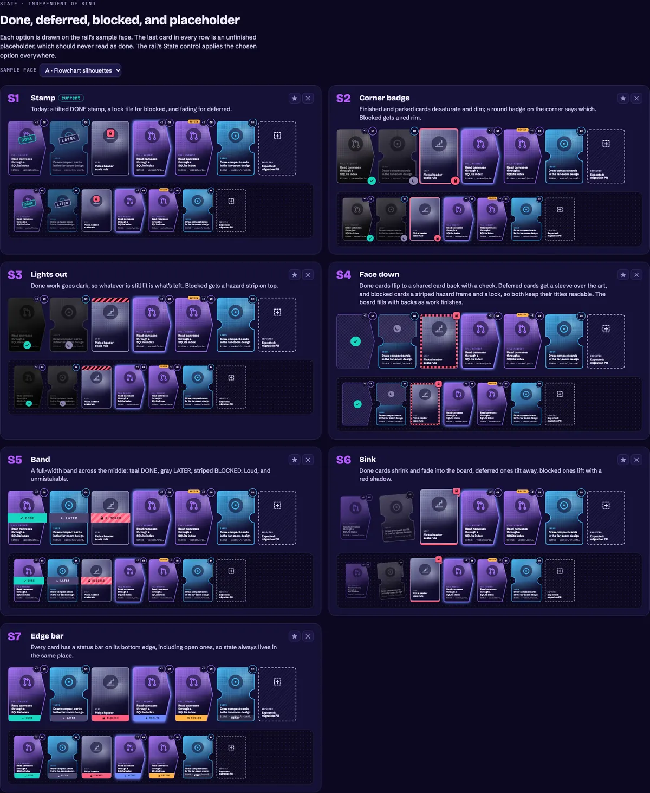
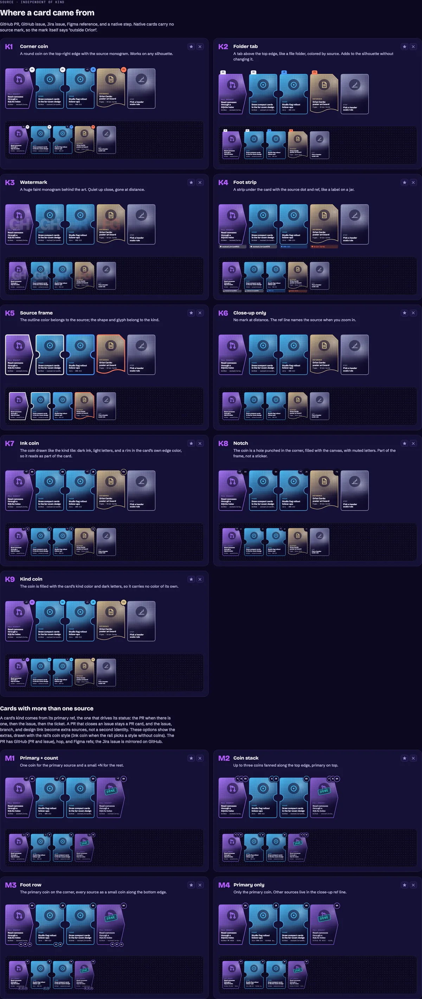
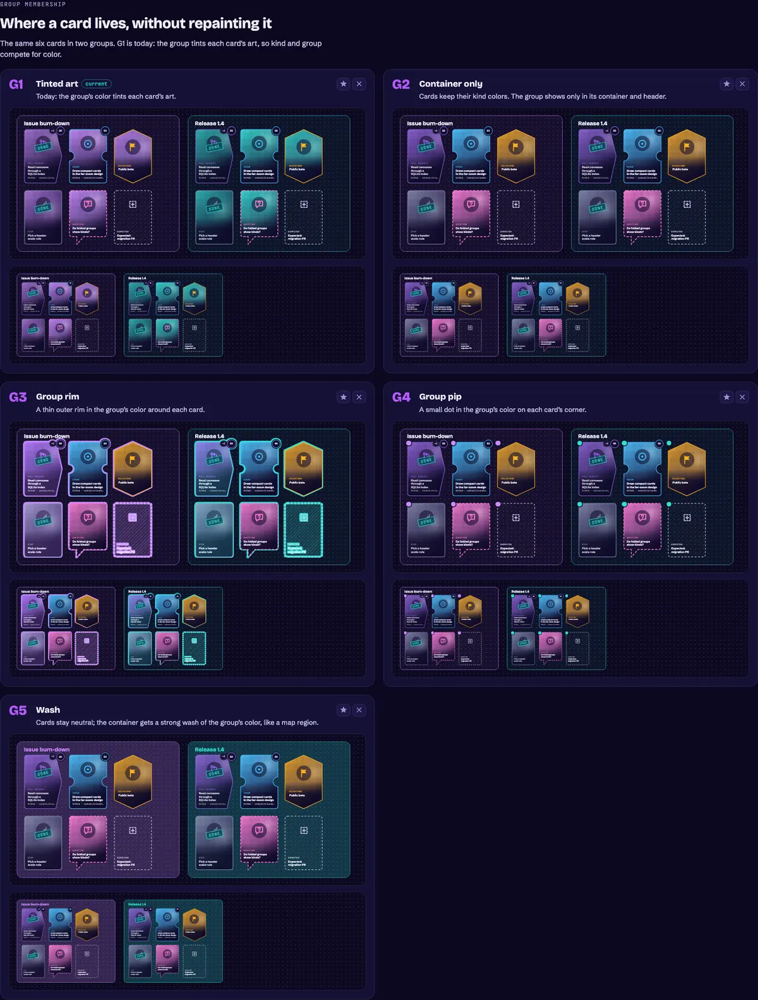
</div>

## Round 2: one shape system, several skins

Round 2 narrowed to the starred directions, with the idea that several could ship as separate card skins. To keep a card's outline meaning the same thing whichever skin is on, every skin shares one shape system and differs only in its art:

- **Pull request:** A's arrow.
- **Issue:** a new outline, chosen from X1 to X6.
- **Gate:** G's octagon, wider than a card so it reads as a landmark.
- **Question and decision:** G's round tokens. A decision is a filled token.
- **Reference:** A's document with a folded corner.
- **Step:** a rounded rectangle. A placeholder is the same rectangle, hollow and dashed.

Round 2 also leaves cards untinted by their group, uses the corner coin with +N for extra sources, and starts from the band and sink states.

### Constellations

Round 1's constellations sampled their stars from the kind's icon, which looked lumpy, and every card shared one flat sky. Round 2 places each figure by hand and gives each card its own sky. J12 to J14 borrow from Skyrim's skill constellations: smoky skies, flared stars, the sign drawn faintly behind, and stars that light up as work moves forward.

| ID  | Variant           | Idea                                                                                           |
| --- | ----------------- | ---------------------------------------------------------------------------------------------- |
| J1  | Drawn figures     | Hand-placed figures on a plain night sky. The control for the rest.                            |
| J2  | Nebula            | A seeded nebula per card in its kind's hue and two neighbors, so no two skies match.           |
| J3  | Milky Way         | A dusty band of stars crosses each card at its own angle.                                      |
| J4  | Horizon           | Twilight over a ridge line, with the title on the dark ground.                                 |
| J5  | Star atlas        | An old star chart: an inked grid, a graduated ring, magnitude dots, and dashed figure lines.   |
| J6  | Sparkle           | Four-point glowing stars over a nebula.                                                        |
| J7  | Stars only        | No lines; the figure comes from the bright stars alone.                                        |
| J8  | Kind skies        | The sky glows in the kind's color behind white figure lines.                                   |
| J9  | Aurora            | Ribbons of aurora in the kind's hue and teal.                                                  |
| J10 | Observatory       | A porthole of sky in a dark card, rimmed in the kind's color.                                  |
| J11 | Far-tuned         | Big stars and thick lines, built to survive 0.33.                                              |
| J12 | Skyrim: lit stars | Stars light up as work moves: one when ready, half when active, most in review, all when done. |
| J13 | Skyrim: sign      | A smoky sky with the kind's icon drawn faintly behind its stars.                               |
| J14 | Skyrim: lit sign  | The faint sign and the lit stars together.                                                     |

In J12 and J14, a blocked card shows a red star where its progress stopped, and a placeholder's stars are hollow.

<div class="gallery">
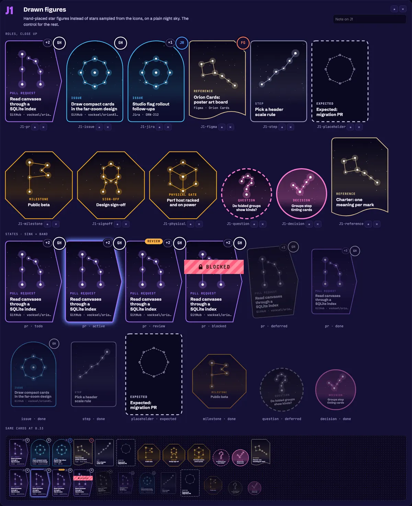
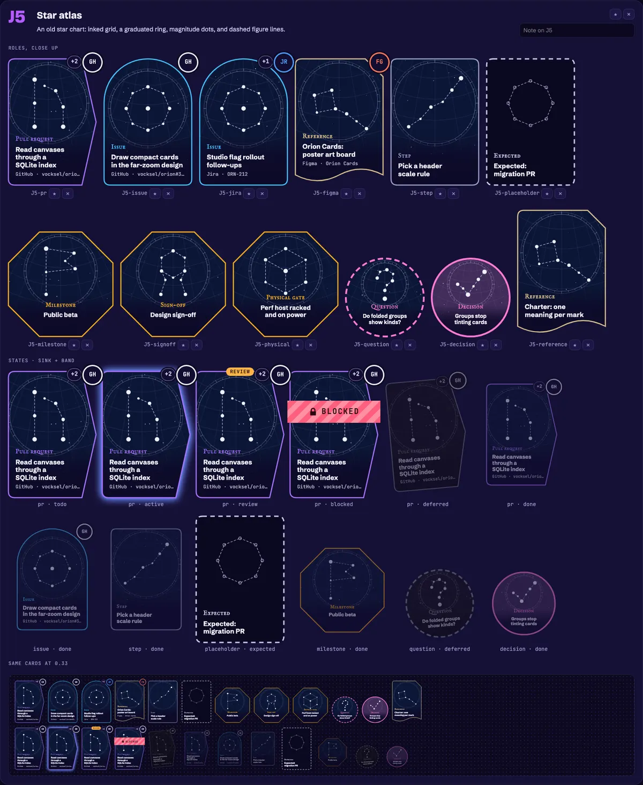
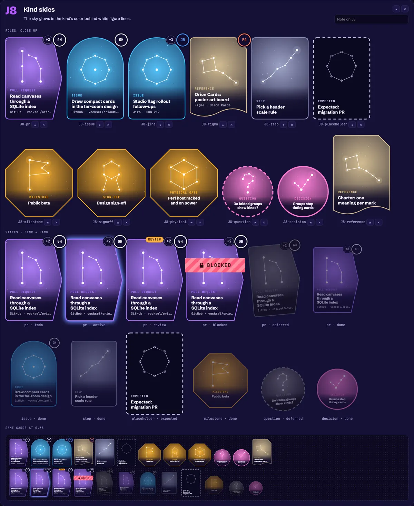
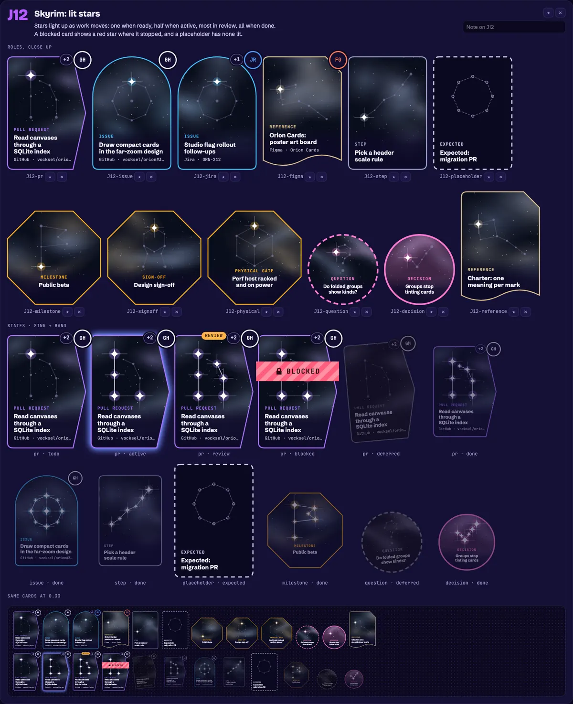
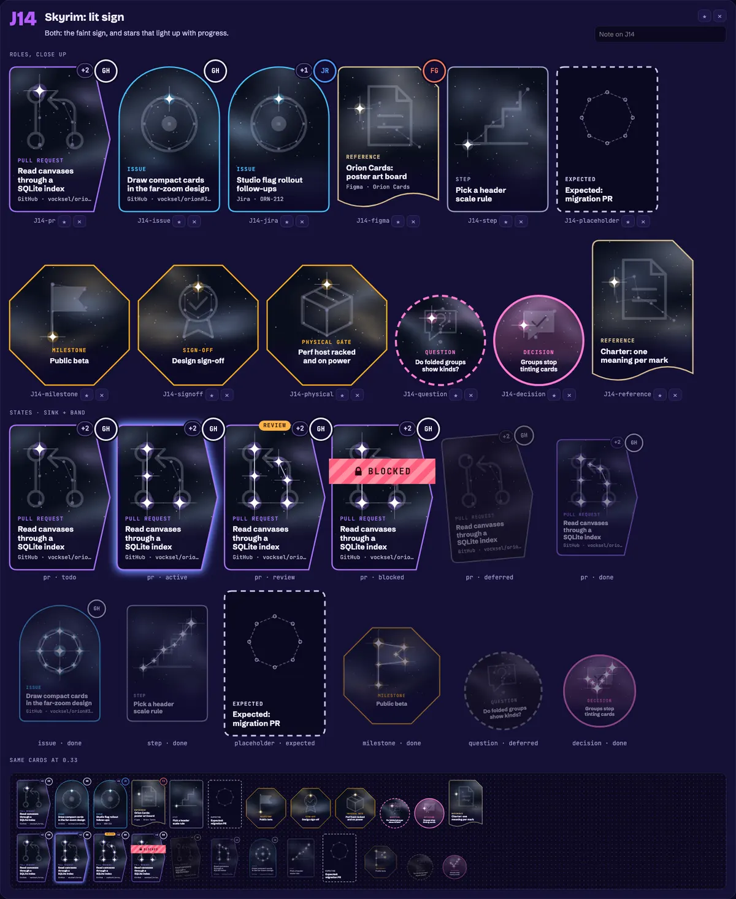
</div>

### Issue outline, pixel, and dithered skins

| ID  | Option         | Idea                                                                     |
| --- | -------------- | ------------------------------------------------------------------------ |
| X1  | Arch           | A round arch on top, which held up best in round 1's grayscale and blur. |
| X2  | Folder tab     | A raised tab on the top left.                                            |
| X3  | Clipped corner | One big chamfer on the top left, like a torn ticket stub.                |
| X4  | Hanger         | A round bump on the top edge, like a tag on a hook.                      |
| X5  | Capsule        | Fully rounded corners, soft against the PR's sharp arrow.                |
| X6  | Punched        | A hole punched near the top, like a claim ticket.                        |
| I1  | Hand sprites   | Sprites drawn by hand on a 12 by 12 grid, over dithered art.             |
| I2  | Shaded sprites | The same sprites with a lit top, a shaded bottom, and a dark outline.    |
| I3  | Chunky frame   | Shaded sprites inside a thick, crisp kind-colored frame.                 |
| I4  | 8-bit night    | Shaded sprites on a pixel starfield, halfway to the constellations.      |
| D1  | Ink disc       | A's dithered art on the shared shapes, with the icon in a dark disc.     |
| D2  | Bright icon    | A larger glowing icon and more of the kind's color in the art.           |

Round 1's pixel sprites were vector icons shrunk onto the grid, which is why some looked mushy. Round 2's are drawn by hand at their real size.

<div class="gallery">
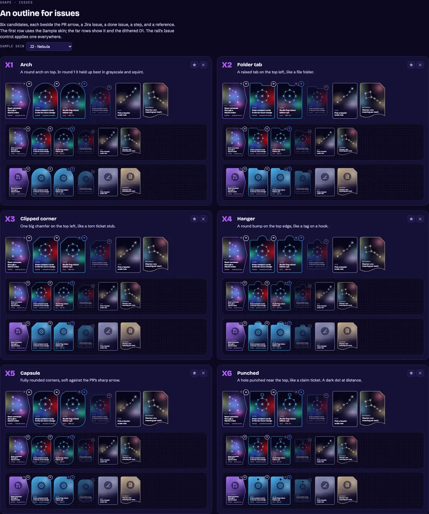
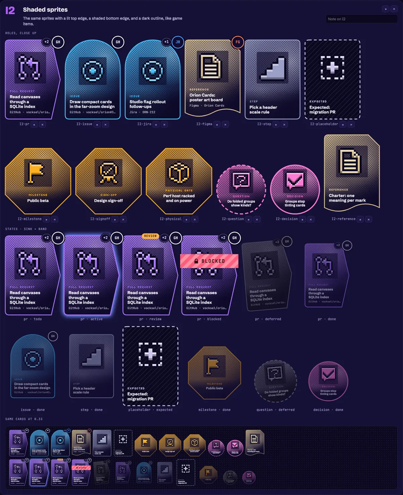
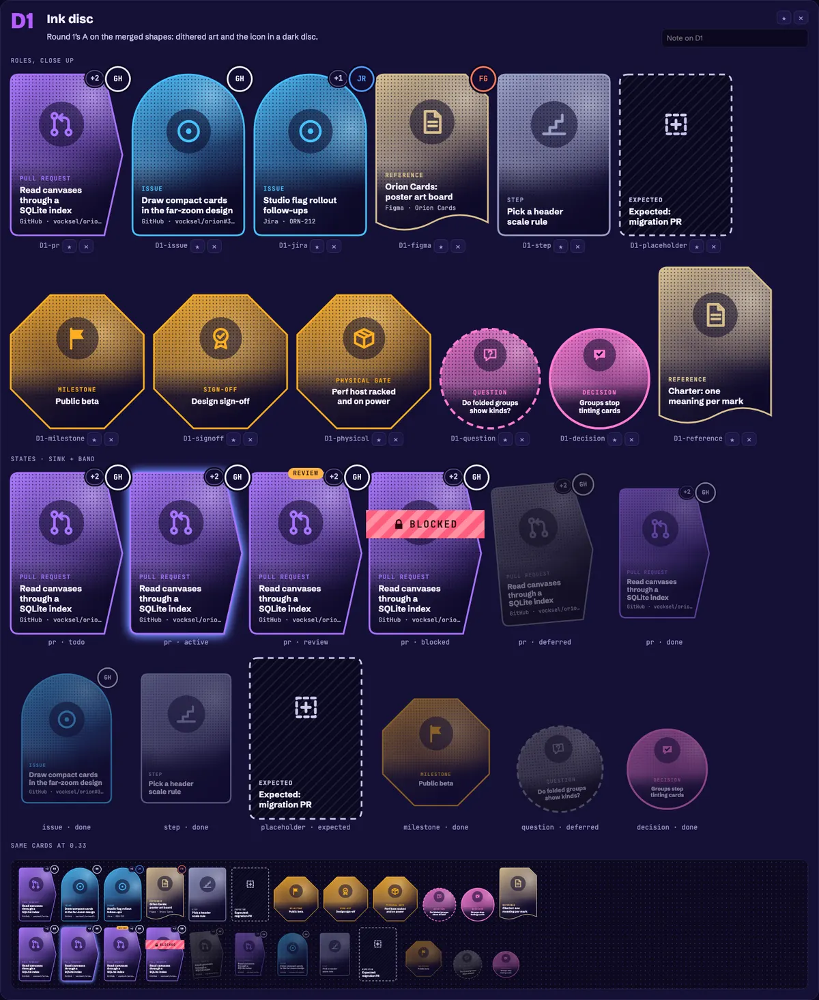
</div>

### State, source, groups, and scale

| ID  | Option           | Idea                                                                                                 |
| --- | ---------------- | ---------------------------------------------------------------------------------------------------- |
| T1  | Sink + band      | Done and deferred cards sink, and blocked cards get a striped band over the art, clear of the title. |
| T2  | Slim band        | A thin band where the art meets the title.                                                           |
| T3  | Band at distance | A small chip up close, a full band at 0.5 and below.                                                 |
| T4  | Sink + ribbon    | Done and deferred cards sink; a corner ribbon names the state.                                       |
| C1  | Brand coin       | Round 1's corner coin, for comparison.                                                               |
| C2  | Brand rim        | A dark coin with the brand color only in its ring and letters.                                       |
| C3  | Small brand coin | The filled coin at two-thirds size, tucked into the corner.                                          |
| C4  | Inset coin       | The coin inside the corner instead of hanging over it.                                               |
| C5  | Planet           | A shaded planet in the brand color, with extra sources as moons.                                     |
| C6  | Skin-native      | Each skin draws its own coin: a planet, a pixel coin, or a rim.                                      |
| W3  | Wash + header    | A lighter wash, with the header bar in the group's color.                                            |
| H5  | Clamped landmark | A landmark header that never draws smaller than about 17 screen pixels.                              |
| R4  | Deck + census    | A folded group shows its next card face up on its deck, with the census beside it.                   |

<div class="gallery">
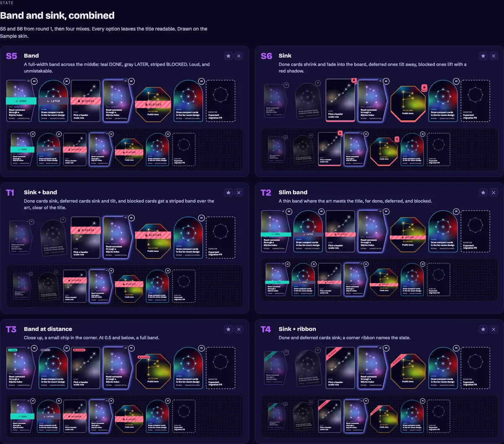
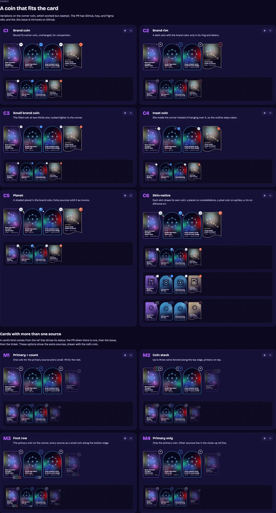
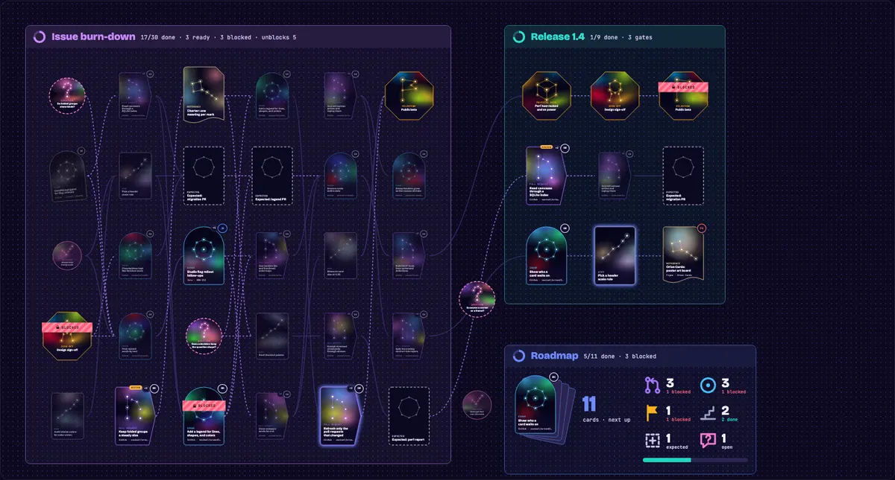
</div>

## Open questions

- Which issue outline joins the shared shapes.
- Which constellation skies to keep, and whether lit stars should replace the state marks on that skin or sit beside them.
- Whether constellations, pixel sprites, and dithered art ship as separate skins on one shape system, or one of them becomes the trading card.
- Whether the source coin is drawn the same on every skin or by each skin.
- How the headers and folded groups chosen here fit the [compact far-zoom card](/development/design/trading-cards).

## Sources

Both galleries live in `docs/development/design/card-identity-sources/` as single HTML files that draw every card as inline SVG. Open one in a browser:

```bash
open docs/development/design/card-identity-sources/round-2.html
```

The rail at the top swaps the vision filter, the state, source, and group marks, and the far zoom. The crowded canvas has a timed test that asks you to click every gate, every unfinished placeholder, or every issue. Stars and crosses save to the browser's local storage.
