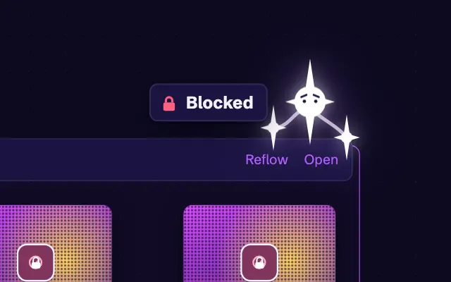
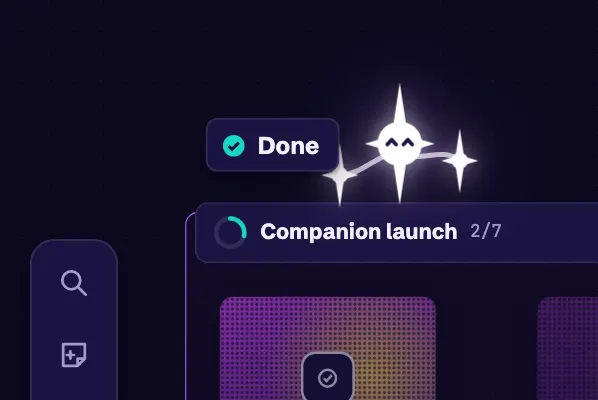
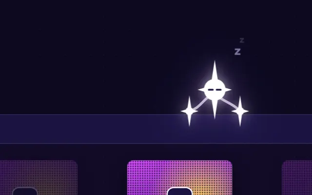
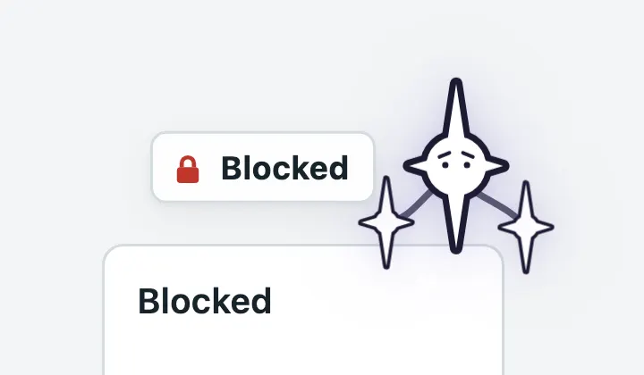

# Companion

The companion is the logo's three stars, brought onto the canvas as a small guide. It perches on the card nearest the pointer, says that card's status in a word or two, and shows a mood that matches it. This page follows it from the study to the app.

## October 7, 2026: The study's companion

The [vibrant study](https://github.com/vocksel/orion/pull/95) first put the companion on the canvas. The logo's stars perched on the card nearest the cursor. The two side stars trailed the body on stiff springs. The companion had a handful of moods, tied to a card's status and to idle time.

Kept: the perch, the trailing stars, and the moods.

## October 12, 2026: In the app

The [companion in the app](https://github.com/vocksel/orion/pull/294) brought the study into Orion. Each mood matches a status:

- A wink, then impatient shifting, at cards waiting on you.
- Sparkly eyes and an arm wiggle at ready cards, and when a sync starts.
- Side-eye at cards in review.
- A happy squint at done cards.
- Worried eyes and drooping arms at blocked cards.

Folded groups show their name and progress, and notes get a quiet perch with no label. After 15 idle seconds, it dozes off until the pointer moves again.

The companion sits above a card, never on its face. For a card in the top row of an open group, it sits above the group's header. It never takes input, pauses while the window is in the background, and with reduced motion it holds still in its corner and shows only its label. It is on by default, and it can be turned off under Appearance in settings.

Its colors come from theme tokens. On dark themes the stars are white and glow. On light themes they are white with a near-black outline, so they stay visible on a pale canvas.

The [decision](/development/decisions#the-companion-is-on-by-default-and-quiet-at-work) behind it: the companion makes the canvas feel alive and reads a card's status at a glance, so it is on by default. Keeping it small and out of the way keeps work mode calm.

## October 17, 2026: Less paint per frame

A [pull request](https://github.com/vocksel/orion/pull/394) is in review to cut the companion's paint work. Panning an open group had got slow once the companion and the Done shimmer were in place, because both repainted every frame even with nothing moving. The tethers now draw in a small layer that moves with the body, and the shimmer steps at 15 frames per second, like the other canvas loops.
