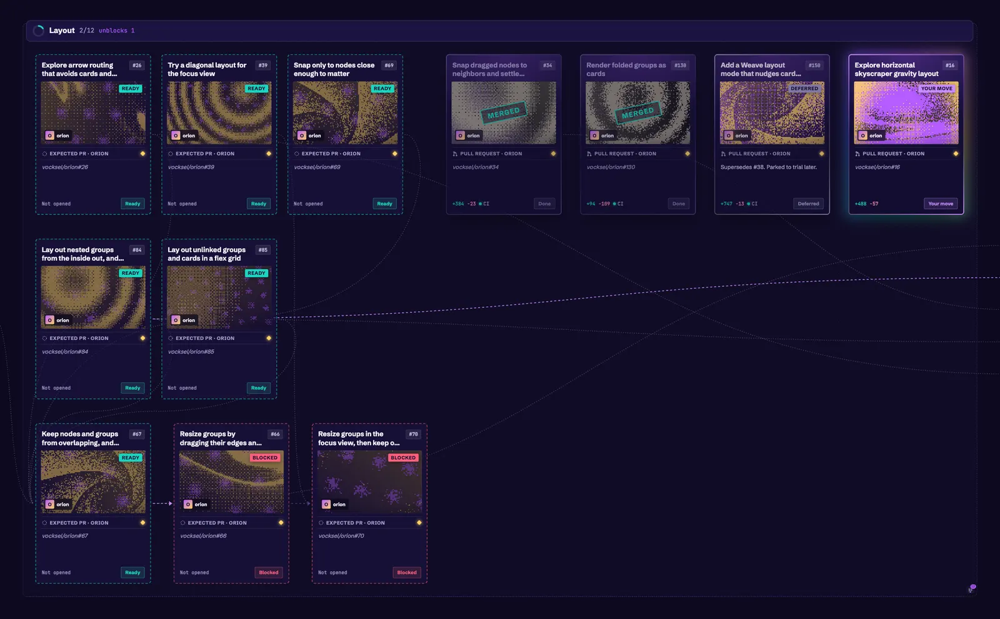
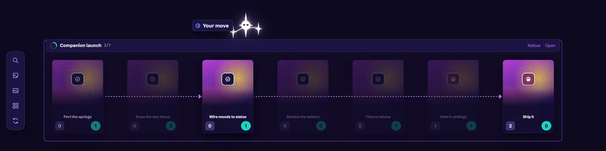
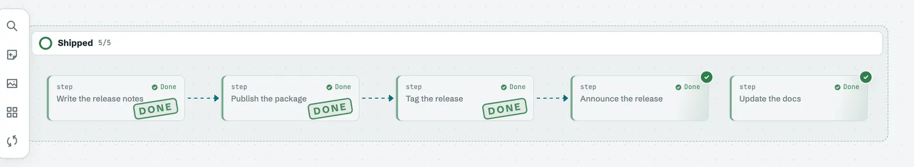
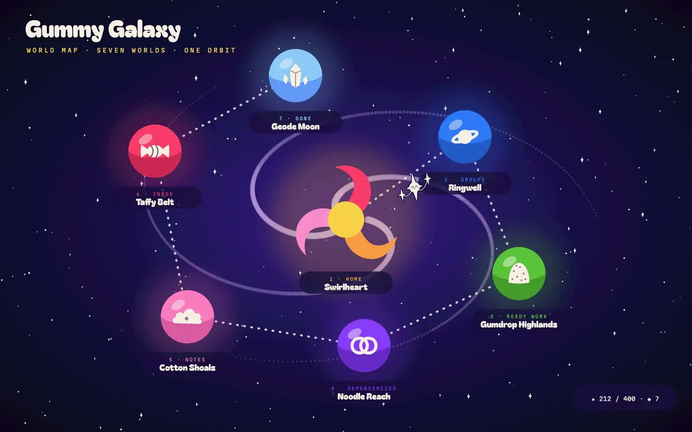

# Design

Design pages cover how Orion looks and feels: its visual direction, how the canvas responds to input, and studies of ideas before they're built.

A study explores an idea and recommends what to keep. It isn't a promise that the idea ships. Once a direction is chosen, the call moves into the [decisions](/development/decisions), and the [Guide](/guide/getting-started) describes what shipped.

## Threads

- [Canvas and layout](/development/design/canvas-and-layout): layout explorations, window chrome, system diagrams, and card details.
- [Card skins](/development/design/cards): each way a card can be drawn, embedded live from Storybook.
- [Companion](/development/design/companion): the star guide that perches on the card nearest the pointer.
- [Gummy Galaxy and Orion](/development/design/gummy-galaxy-and-orion): the Luau-centered vision around Orion and the hands-on canvas ideas it inspires.
- [Gummy Galaxy concept art](/development/design/gummy-galaxy-concept-art): Gummy Galaxy drawn as a game, with its worlds, their emblems, the companion, and the sources to render them again.
- [Logo](/development/design/logo): the icon's studies, its palettes, and the sources for drawing it again.
- [Motion and feel](/development/design/motion-and-feel): what moves and what stays still, and the effects for finished work.
- [Themes and skins](/development/design/themes-and-skins): the vibrant theme, swappable themes, and card skins.
- [Trading cards](/development/design/trading-cards): the card skin, its rarity and kinds, and its compact form at far zoom.

## Live components

Components on these pages are the app's own, embedded from its [Storybook](https://main--6acd7d37ef902af0d3845e73.chromatic.com). The Storybook workflow publishes it to Chromatic whenever a change to the app lands on `main`, so the pages always show what `main` draws. To embed a story, use its id from the Storybook URL:

```md
<Story id="canvas-cards-and-edges-tradingcard--playground" title="A pull request in review" :height="440" />
```

Locally, `npm run dev` in `docs/` embeds from `npm run storybook` in `app/` instead, so stories you're editing show up as you change them.

## Timeline

Each entry is dated by when its pull request was opened.

### October 5, 2026

- [Animate less, and only where motion can be seen](https://github.com/vocksel/orion/pull/29): idle loops stop off screen and below 0.6 zoom.
- [Explore horizontal skyscraper gravity layout](https://github.com/vocksel/orion/pull/16): a skyline layout for top-level groups, explored.

### October 6, 2026

- [Explore Orion, Star Charter, and Artemis icons](https://github.com/vocksel/orion/pull/47): three names, two directions each, judged at Dock size.
- [Spike trading card nodes and hands](https://github.com/vocksel/orion/pull/31): every card drawn as a trading card, explored.
- [Show blockers in front of waiting work instead of Blocked labels](https://github.com/vocksel/orion/pull/32): blockers as gateways, explored.

### October 7, 2026

- [Replace the app icon and keep the logo sources](https://github.com/vocksel/orion/pull/92): three stars over the card art's grain gradient.
- [Study a vibrant theme with dithered trading-card nodes and a star companion](https://github.com/vocksel/orion/pull/95): the study behind the Vibrant theme, the trading cards, and the companion.


_Card text from other projects is blurred in the vibrant study images._

### October 8, 2026

- [Explore Orion, Star Charter, and Artemis icons](https://github.com/vocksel/orion/pull/131): the icon study carried onto current main.

### October 9, 2026

- [Make themes swappable and add a vibrant purple theme](https://github.com/vocksel/orion/pull/149): one CSS file per theme, and Vibrant shipped.
- [Add a card skin registry with Classic and Plain skins](https://github.com/vocksel/orion/pull/154): skins draw cards apart from the theme.
- [Add a trading card skin](https://github.com/vocksel/orion/pull/159): the study's cards in the app.



- [Give cards a rarity from the work that feeds into them](https://github.com/vocksel/orion/pull/161): rarity from upstream work, shown as a set symbol.
- [Add a Conventional theme and card skin](https://github.com/vocksel/orion/pull/156): set aside.
- [Add a Board card skin](https://github.com/vocksel/orion/pull/157): set aside.
- [Give each card kind its own silhouette, symbol, and tint](https://github.com/vocksel/orion/pull/162): closed as a separate pass.
- [Draw trading card art as geometric posters built from each card](https://github.com/vocksel/orion/pull/164): set aside.
- [Study card variety: kind identity, geometric art, rarity, and layouts](https://github.com/vocksel/orion/pull/163): explored.
- [Add a Weave layout mode that nudges cards off the lines crossing them](https://github.com/vocksel/orion/pull/150): cards move off the lines through them, explored.

### October 10, 2026

- [Update the app icon to the new star logo](https://github.com/vocksel/orion/pull/178): four-point stars on the tide background.
- [Draw Orion's own window chrome](https://github.com/vocksel/orion/pull/198): the desktop app draws its own title bar.
- [Draw system diagrams with components and labeled links](https://github.com/vocksel/orion/pull/201): components, shapes, and labeled links for drawing systems.

### October 11, 2026

- [Name design tokens for colors, status, type, radii, and spacing](https://github.com/vocksel/orion/pull/256): themes set named values.
- [Load shareable theme files from the data folder](https://github.com/vocksel/orion/pull/263): a theme can travel as a file.
- [Give canvases and groups a cover and background](https://github.com/vocksel/orion/pull/264): image covers and dimmed backgrounds.
- [Show a finish stamp on finished cards that clears through the chain](https://github.com/vocksel/orion/pull/257): the chain clears one hop at a time.
- [Redesign the trading card so each part has one job](https://github.com/vocksel/orion/pull/275): one job for each part of the card.
- [Record that foil marks rarity and priority lifts it](https://github.com/vocksel/orion/pull/286): foil follows rarity.

### October 12, 2026

- [Bring the star companion into the app](https://github.com/vocksel/orion/pull/294): the companion perches on the nearest card and reacts to its status.



### October 13, 2026

- [Stamp finished cards Done once they're closed out](https://github.com/vocksel/orion/pull/322): a Done stamp on closed-out cards.



- [Draw compact cards and drop related links at far zoom](https://github.com/vocksel/orion/pull/332): far-zoom cards keep the essentials.
- [Draw only the cards near the view, nearest first](https://github.com/vocksel/orion/pull/345): cards far from the view don't draw their bodies.
- [Preview what a folded group holds](https://github.com/vocksel/orion/pull/339): faded previews inside folded groups.
- [Give canvases and groups a Markdown header](https://github.com/vocksel/orion/pull/347): a header band for canvases and groups.
- [Give card details a roomier panel with Markdown notes and collapsible links](https://github.com/vocksel/orion/pull/342): a wider details panel.

### October 15, 2026

- [Add a charter section on designing for the senses](https://github.com/vocksel/orion/pull/382): feel, sound, and focus as goals for Orion.

### October 17, 2026

- [Keep faded trading cards opaque](https://github.com/vocksel/orion/pull/393): links no longer show through a faded card.
- [Draw every compact trading card as the poster card](https://github.com/vocksel/orion/pull/391): merged October 17.
- [Cut the companion's and done shimmer's per-frame paint work](https://github.com/vocksel/orion/pull/394): in review.

### October 18, 2026

- [Add Gummy Galaxy concept art to the design docs](https://github.com/vocksel/orion/pull/460): seven draft worlds, their emblems, and the studies behind them.


