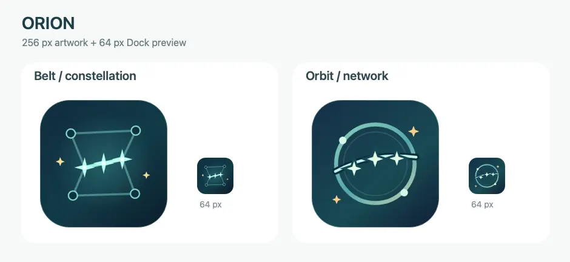
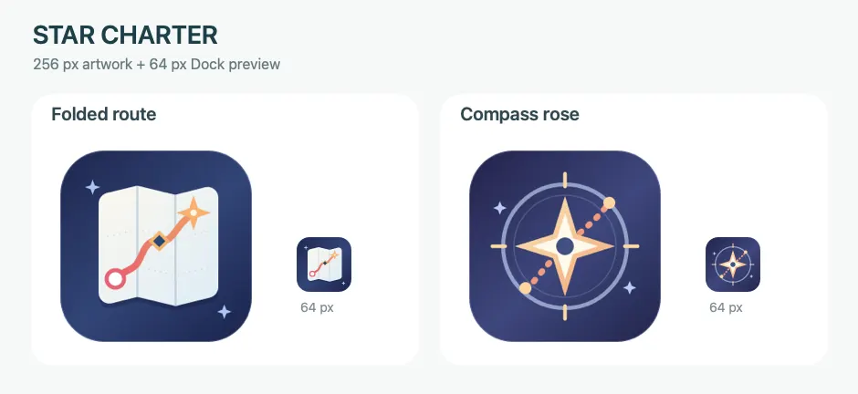
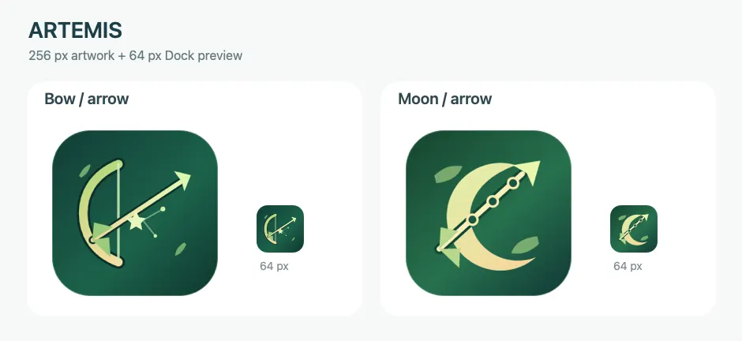
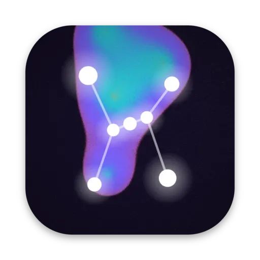
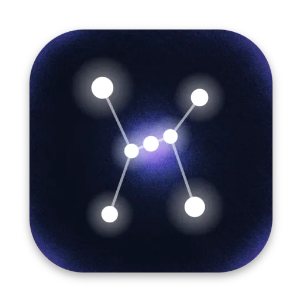
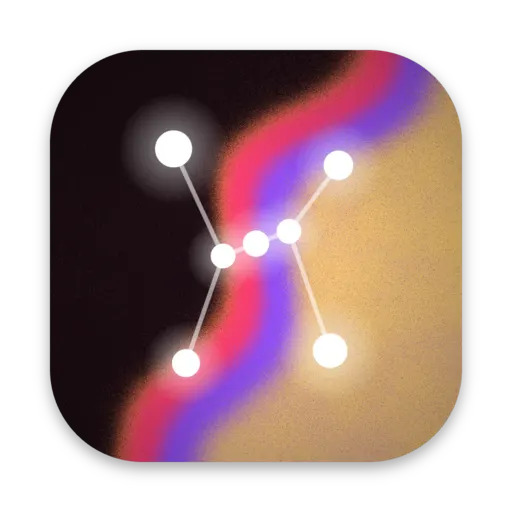
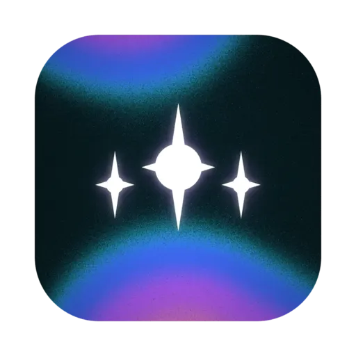

# Logo

The logo is Orion's belt, three stars over the grain gradient that the trading cards use for their art. This page covers how the icon changed, the palettes it was tried in, and the sources for drawing it again.

## October 6 to 8, 2026: Icon studies

The [icon study](https://github.com/vocksel/orion/pull/47) tried three names, Orion, Star Charter, and Artemis, with two directions for each. Each direction was reviewed at 256 px for the artwork and at 64 px for the Dock preview. A [follow-up exploration](https://github.com/vocksel/orion/pull/131) carried the study onto current main on October 8.

Orion kept its name. The Star Charter and Artemis directions were set aside.







## October 7, 2026: First app icon

The [first app icon](https://github.com/vocksel/orion/pull/92) replaced a placeholder with the tide icon from Figma: three stars over the grain gradient from the card art. The icon is kept as two layers. The background is a rounded square with the grain and a soft vignette, and the stars sit above it in their own file.

Earlier renders in the dusk, nebula, and ember palettes put the stars on a diagonal, joined by a line, over the same kind of background. Those renders are shown under [palettes](#palettes). Kept: the tide palette and the layered sources. Set aside: the diagonal constellation as the icon's motif. It stays in the sources as `stars.svg`.

## October 10, 2026: Four-point stars

The [new star logo](https://github.com/vocksel/orion/pull/178) kept the tide background and replaced the stars with four-point ones, exported from Figma. This is the icon the app uses today. The stars were later drawn as a companion on the canvas, covered in [companion](/development/design/companion).

## Palettes

These are the four palettes the icon was drawn in, rendered with the same layout. Dusk, nebula, and ember were the early renders with the constellation. Tide is the current icon.

<div class="gallery">




</div>

## Sources

The logo's layers, its earlier renders, and a small page that draws them again live in `docs/development/design/logo-sources/`.

- `tide-background.png` and the other `<palette>-background.png` files are the rounded square with its grain gradient and vignette. They have no drop shadow.
- `stars.svg` holds the earlier diagonal stars and the line between them, on the same 1024 px canvas. The Figma file holds the current stars.
- `tide.png`, `dusk.png`, `nebula.png`, and `ember.png` are the full icons with the stars on top.
- `index.html`, `server.mjs`, `package.json`, and `package-lock.json` make up the page. It renders every palette at 1024 px with [Paper Shaders](https://github.com/paper-design/shaders). The grain's speckle changes a little between renders, but the colors and layout stay the same.

To render the icons again, run the page from its folder:

```bash
cd docs/development/design/logo-sources
npm install
node server.mjs
```

Open `http://localhost:5230`, then run `saveIcon('tide')` or `saveIcon('tide-background')` in the console to write that image into the folder. To generate the desktop app's icon sizes, run `npx tauri icon docs/development/design/logo-sources/tide.png` and keep only the files `tauri.conf.json` lists. Build `icon.icns` without the 1024 px size with `iconutil`, since the grain barely compresses.
