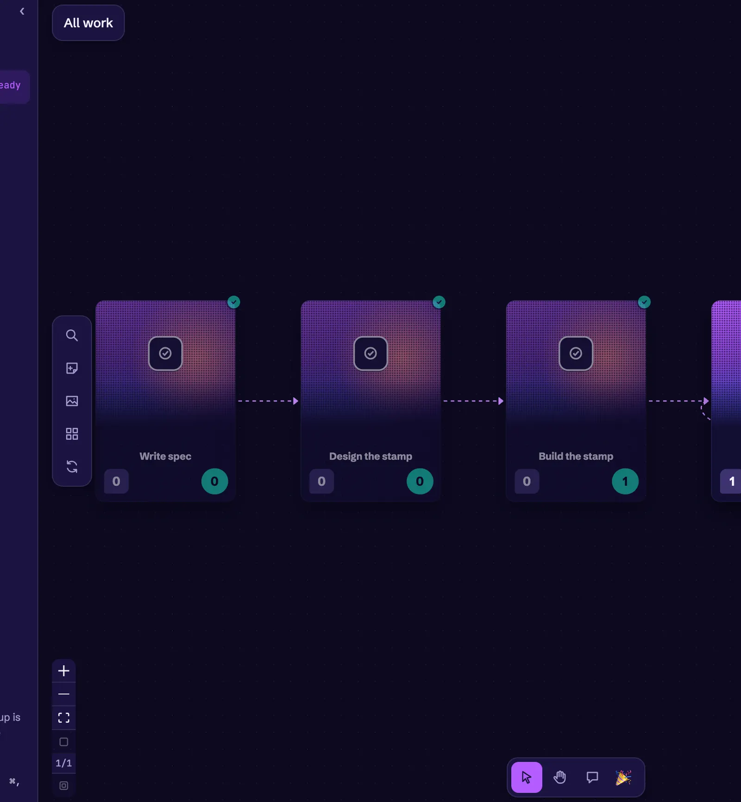
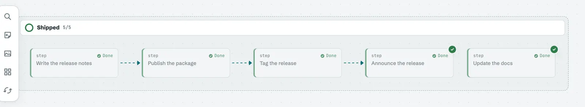

# Motion and feel

This thread covers the motion across the canvas and the effects that mark finished work. Motion should say something, such as a card changing, a piece of work finishing, or a rule applying.

## October 5, 2026: Animate less

The [animate-less change](https://github.com/vocksel/orion/pull/29) stopped idle motion from costing the GPU. While the app sat idle, the WebKit GPU process stayed near 40% CPU, because each changed frame repainted everything under the moving arrows and glows.

Arrows, the active glow, and the attention line now step at 15 frames per second through `steps()`, which WebKit schedules per step rather than per display frame. The glow pulses every 3.2 seconds and rests for the second half of each cycle. Loops stop below 0.6 zoom, while the window is in the background or hidden, on arrows a trace dims, and on arrows that are off screen.

Kept: the motion itself, at lower frame rates and only where it can be seen. Set aside: loops that run everywhere, whether or not anyone can see them.

## October 11, 2026: Finish stamp that clears through the chain

The [finish stamp](https://github.com/vocksel/orion/pull/257) marks a finished card with a small stamp until someone clicks it. Clicking clears the stamp on that card and on every connected finished card that is still waiting, so a run of finished work clears as a chain. Each hop starts 90 ms after the one before it, for up to eight hops. Only the stamp animates, with transform and opacity, so cards never move under the pointer. With Animations set to Reduced or Off, the stamps clear at once.

Finishing work should feel like finishing. Before this change, the chain ran too fast to savor, and the charter asks that rewards take time to savor.

## October 13, 2026: Done stamp

The [Done stamp](https://github.com/vocksel/orion/pull/322) marks a card that is done and closed out. The stamp sits in the card's lower right, tilted like a rubber stamp, and reads as finished on its own without other cards beside it to compare against. Done cards fade only a little, to 88% opacity, or 80% on trading cards.

Fading alone made done cards look like blocked and deferred work. A finished card waiting to be closed out shimmers and keeps its check badge, labeled "Close out". The stamp lands on each card as its badge clears, following the chain's stagger.

Kept: the stamp, the shimmer, and the chain's stagger. Left for later: a catalog of other completion stamps, and closing out straight from the card menu.

## October 15, 2026: Made for the senses

The [charter section on designing for the senses](https://github.com/vocksel/orion/pull/382) states that Orion should feel good to touch, look at, and listen to. It asks for feedback sized to each moment, rewards that take time to savor, room to focus, and settings that let people turn each sense up, down, or off. The section sits after the charter's game feel section, and it points at the issues that put it into practice.

Read the [charter](/development/charter#made-for-the-senses) for the full text.
