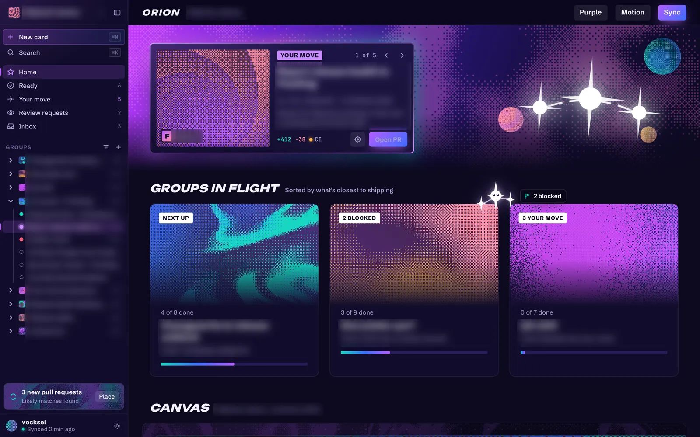
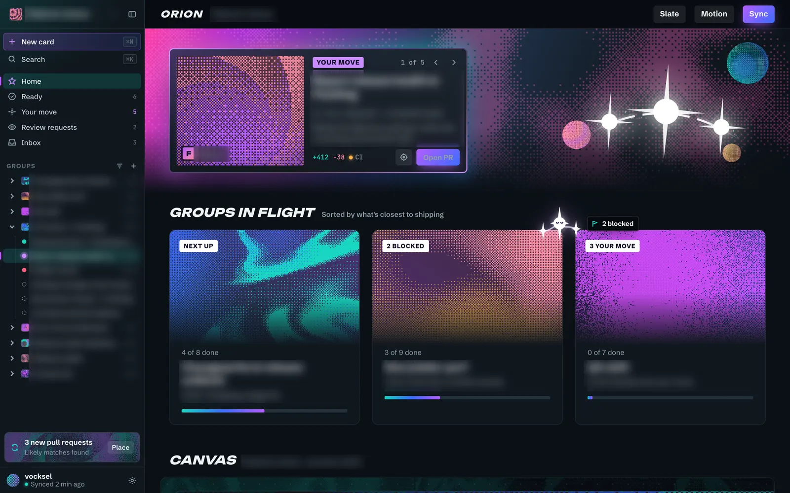
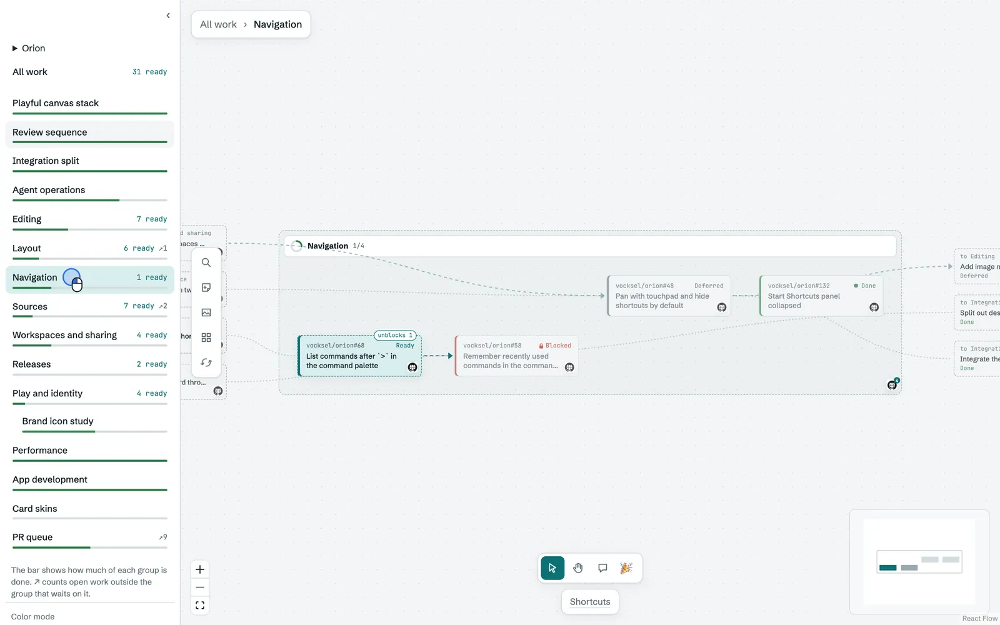
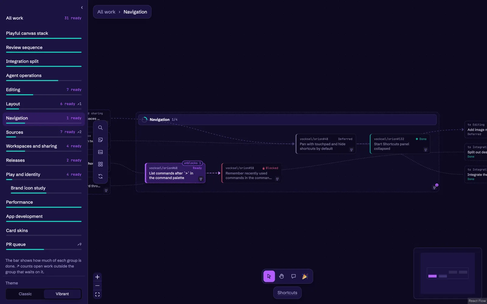
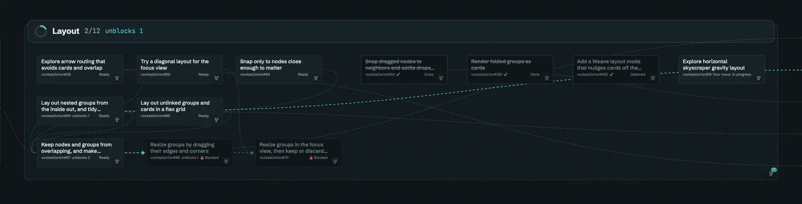
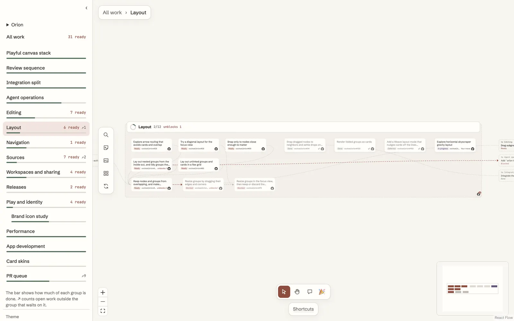
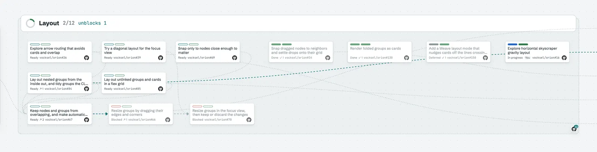

# Themes and skins

A theme sets the colors, type, and shapes of the whole app. A skin changes how one card is drawn, independently of the theme. This page follows how both were added and what was kept.

## October 7, 2026: Vibrant study

The [vibrant theme study](https://github.com/vocksel/orion/pull/95) started from the Discord mobile app, whose big tiles, bold color, and eye-catching graphics suggested a more vivid look for Orion. Dithered art from Paper Shaders gave the graphics a procedural texture. The study used a dark purple palette built from the logo's inks, and it was a single page that did not touch the app. A Slate palette tried a cooler look in the spirit of Hyper Light Drifter, with a few neon accents over desaturated blue-gray. The sidebar was dense, like a code editor's, with groups as a tree of cards and status dots.

Kept: the purple palette, which became the Vibrant theme. Set aside: the Slate palette, which is not part of the Vibrant theme.

## October 9, 2026: Swappable themes

The [theme change](https://github.com/vocksel/orion/pull/149) separated the theme from the color mode. Each theme is a CSS file under `app/src/themes/`, listed in one place, so a new direction can be tried by adding one file. Colors use `light-dark()`, so light, dark, and system mode only set the color scheme. The sidebar gets a Theme switch, and the Vibrant theme shipped with the change. It is dark only.

Kept: Classic as the original palette, and Vibrant as the second theme.

## October 9, 2026: Card skins

The [skin registry](https://github.com/vocksel/orion/pull/154) lets each card be drawn in a different skin. It started with Classic, the existing card, and Plain, a flat card with a hairline border and a small radius. A skin's size comes from the registry, so a skin can ask for a different card size. Like the theme, the choice is an app preference saved in the data folder, not part of any canvas.

Two more skins were tried as separate pull requests, and both were closed rather than shipped.

- The [Conventional skin](https://github.com/vocksel/orion/pull/156) was a warm off-white look, like the calm desktop chat apps. It had a soft card with a generous radius and a quiet meta line. It was set aside.
- The [Board skin](https://github.com/vocksel/orion/pull/157) drew cards like kanban cards, with label chips across the top for status and repository. It was set aside.

## October 11, 2026: Named tokens and shareable themes

The [named tokens](https://github.com/vocksel/orion/pull/256) gave colors, status, type, radii, and spacing names, so a theme sets a known set of values instead of reaching into the app's styles. The [shareable theme files](https://github.com/vocksel/orion/pull/263) load from the data folder, so a theme can be copied between machines as a file.

The charter asks for this. Nearly every visible property has a named token, and themes are files of those tokens. See the [theme tokens](/guide/tokens) and [themes](/guide/themes) guides, and the [charter](/development/charter).
