# Trading cards

The trading card skin draws each work item as a collectible card, with its kind, rarity, status, and a piece of art made from the card's own data. This page follows the spike, the study, the skin in the app, and the rules the cards keep.

## October 6, 2026: Spike

The [trading card spike](https://github.com/vocksel/orion/pull/31) drew every card as a trading card, to see how a canvas of work feels as a deck. Cards kept 63:88 proportions, with a fixed place for each part: title and cost on top, art, a type line with the status, a text box, and details along the bottom. A group could be held as a hand, with its cards overlapping and fanning out on hover, and a folded group was drawn as a deck. Cards where it was your move were foils.

Hovered cards tilted toward the pointer, and the rest lay flat, because tilted layers blurred on the zoomed WebKit canvas. The spike stayed open as an exploration. The study that followed kept its top-to-bottom layout.

## October 7, 2026: The study's cards

The [vibrant study](https://github.com/vocksel/orion/pull/95) set the card direction. Cards were 288 by 400 with a title bar, an art window, a type line, a text box, and a status box. The art was dithering from Paper Shaders, seeded by the card's id so it never changed. Each repository picked the colors, and each card kind picked the pattern. Hovering tilted the card and added a holo foil to the art and frame.

The holo foil made text on a hovered card hard to read, so the rule became: holo and tilt never touch text.

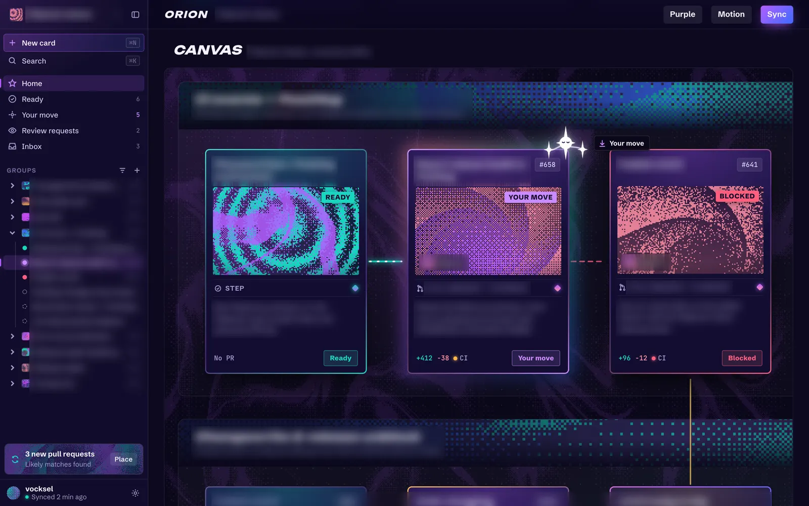
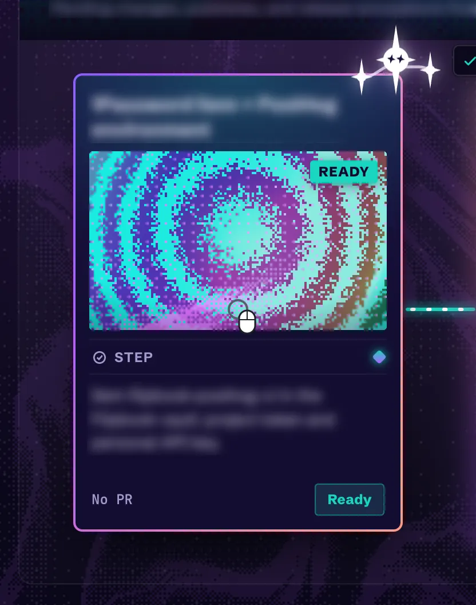

## October 9, 2026: The first trading card skin

The [trading card skin](https://github.com/vocksel/orion/pull/159) brought the study into the app as a skin, using the per-skin card sizes from the [skin registry](/development/design/themes-and-skins). Its back is dark, with a border tinted by status. Status and checks use the same icons and colors as the classic cards, so colorblind palettes and shapes carry over. The art is a dithered still painted by a small shared pool of hidden shader mounts and cached by seed, so cards never each open a WebGL context.

## October 9, 2026: Rarity

[Rarity](https://github.com/vocksel/orion/pull/161) comes from the work that feeds into a card. Each card counts the distinct cards that reach it through blocking links, and done cards still count, so a card's rarity doesn't drop as its inputs finish. Common is below 4, uncommon starts at 4, rare at 8, and mythic at 14. Each tier has a shape as well as a color: a circle, a diamond, a star, or a burst. The diamonds follow Pokémon TCG Pocket's rarity diamonds.

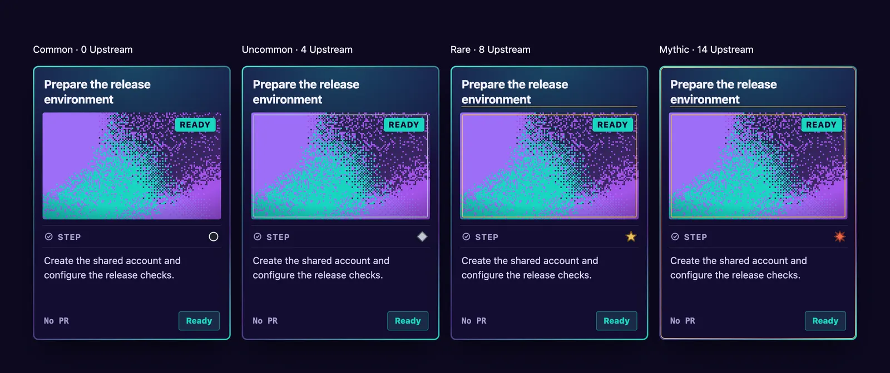

Later, priority joined the count. See [October 11](#october-11-2026-one-job-per-part-and-foil-is-rarity).

## October 9, 2026: Kinds and the variety study

Two explorations asked how cards should tell their kinds apart. Like a land type in Magic: The Gathering, the [kind pass](https://github.com/vocksel/orion/pull/162) gave each kind its own silhouette, symbol, and tint. Slay the Spire's frame shapes set the outlines. Square corners mark steps, a chamfered top marks pull requests, a dashed portal marks expected pull requests, an arch marks gates, and a folded corner marks notes. It was closed as a separate pass, and the kind idea carried into the study and the later card face.

The [card variety study](https://github.com/vocksel/orion/pull/163) is still open. It draws on how digital card games signal type and rarity, and it tested kind palettes that stay distinct in grayscale, a rarity ladder, and five layouts over the same 17 cards. Its fifth layout, the evolved card, keeps the current title, art, type, detail, and footer rhythm, and adds kind-shaped frames and a restrained rarity seal. A mixed canvas of 24 cards checked whether cards stand apart without repository colors.

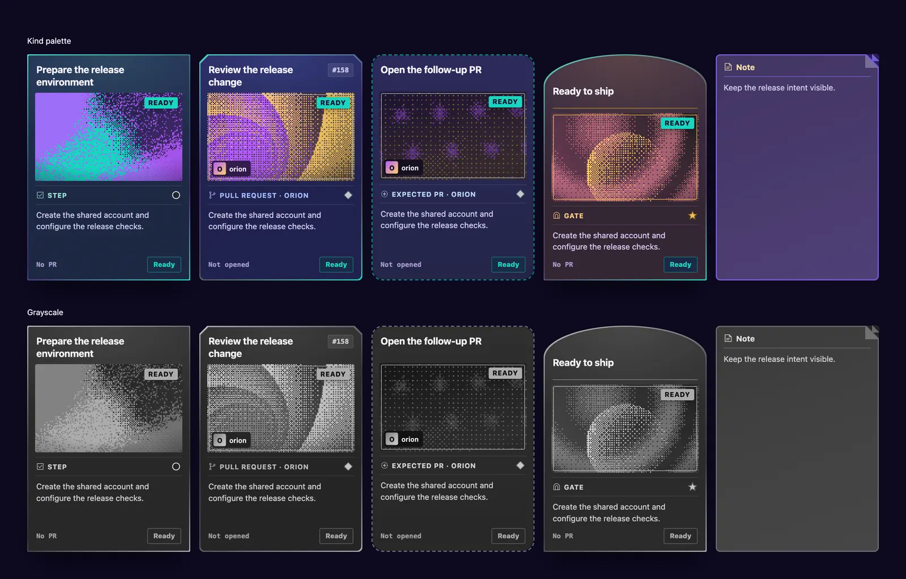

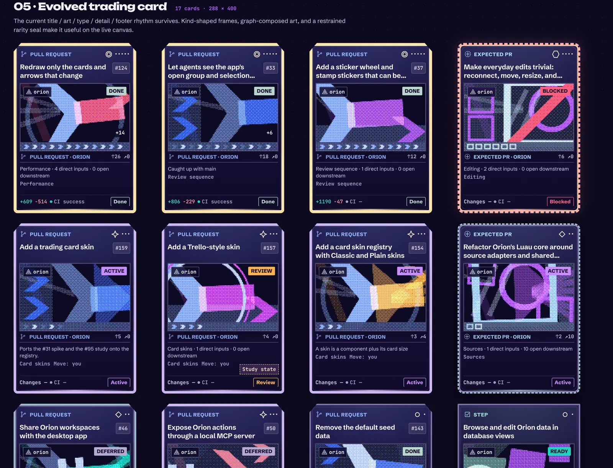

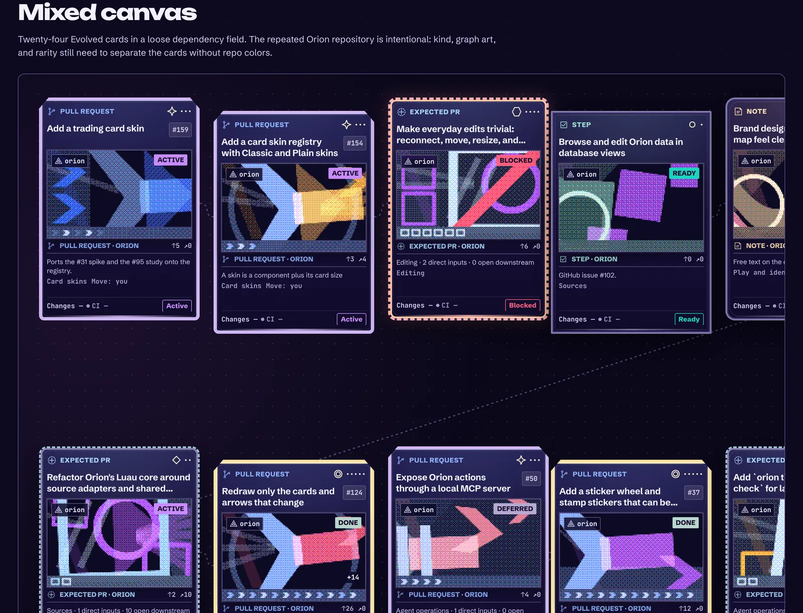

## October 9 to 12, 2026: Posters, set aside

The [poster art](https://github.com/vocksel/orion/pull/164) drew each card's art as geometric posters: squares and tiles for steps, chevrons for pull requests, arches for gates, and ribbons for notes. Six seeded compositions per kind kept neighbors apart, and upstream work, leverage, and status showed as parts of the poster. It was closed. The posters leaned on geometry for its own sake, and a card needs to be recognized at a glance.

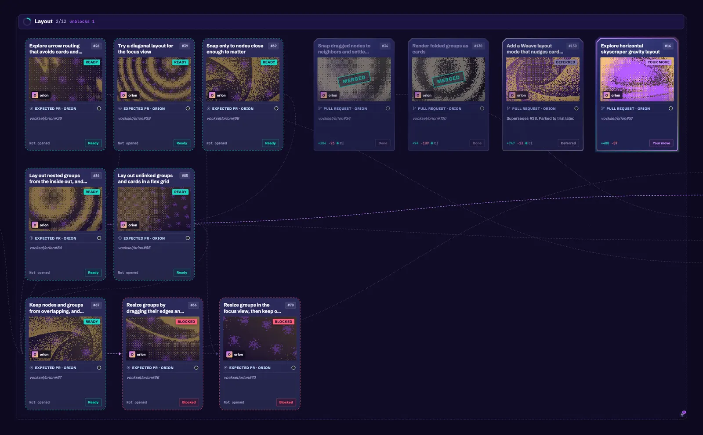
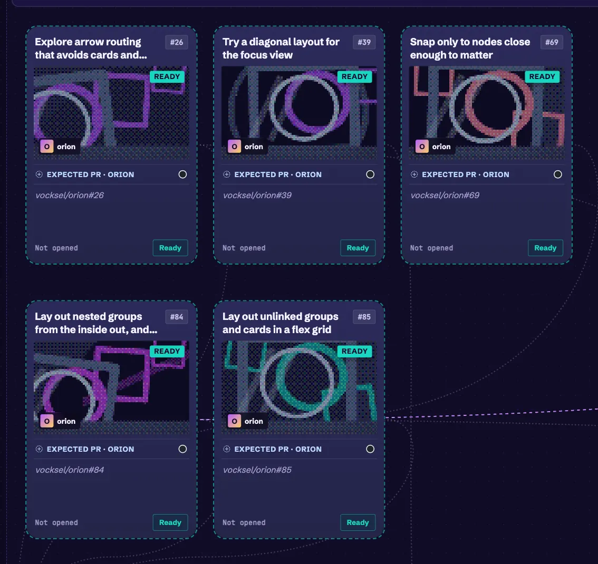

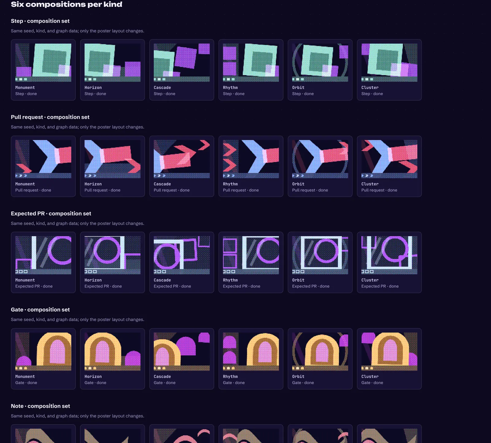

## October 11, 2026: One job per part, and foil is rarity

The [card redesign](https://github.com/vocksel/orion/pull/275) gave each part of the card one job. Facts such as priority and size sit at top left, colored by severity. One sticker at top right shows the most urgent status that asks for action, and disappears when nothing needs anyone. The kind icon sits in the center, open blockers and checks sit at the bottom, and direct unblocks sit at the bottom right. The card no longer repeats itself, such as a repository name above a label that names the same repository.

"Your move" appears only on the card that is actually yours to act on. Before, it appeared on everything, which was noise.

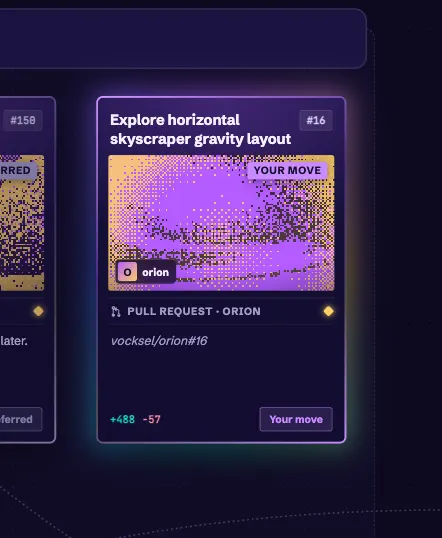

The [foil decision](https://github.com/vocksel/orion/pull/286) made rarity the one finish ladder. Uncommon cards get a silver edge, rare cards a foil edge, and mythic cards a foil edge with holo over the art. Marvel Snap's escalating finishes shaped that ladder. Priority lifts rarity, with P0 two tiers and P1 one. The same decision records that card art is a night-sky scene picked by kind. See the [decisions](/development/decisions#cards) for the wording and reasons.

## October 13, 2026: Compact cards at far zoom

At far zoom, the full card shrinks into text no one can read. The [compact form](https://github.com/vocksel/orion/pull/332) keeps the art, kind, facts, title, and bottom row, draws them larger, and hides related links. The breakpoint stays at 0.3 times zoom. Status badges keep only their icon.

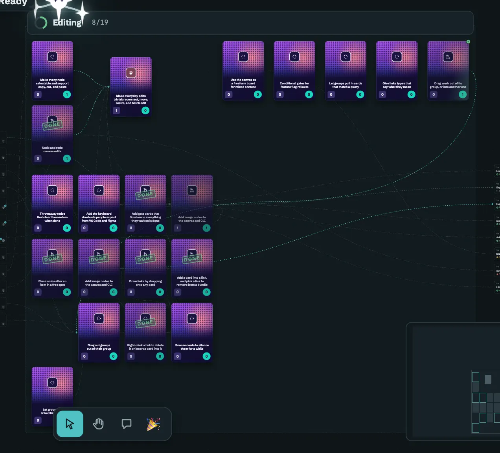
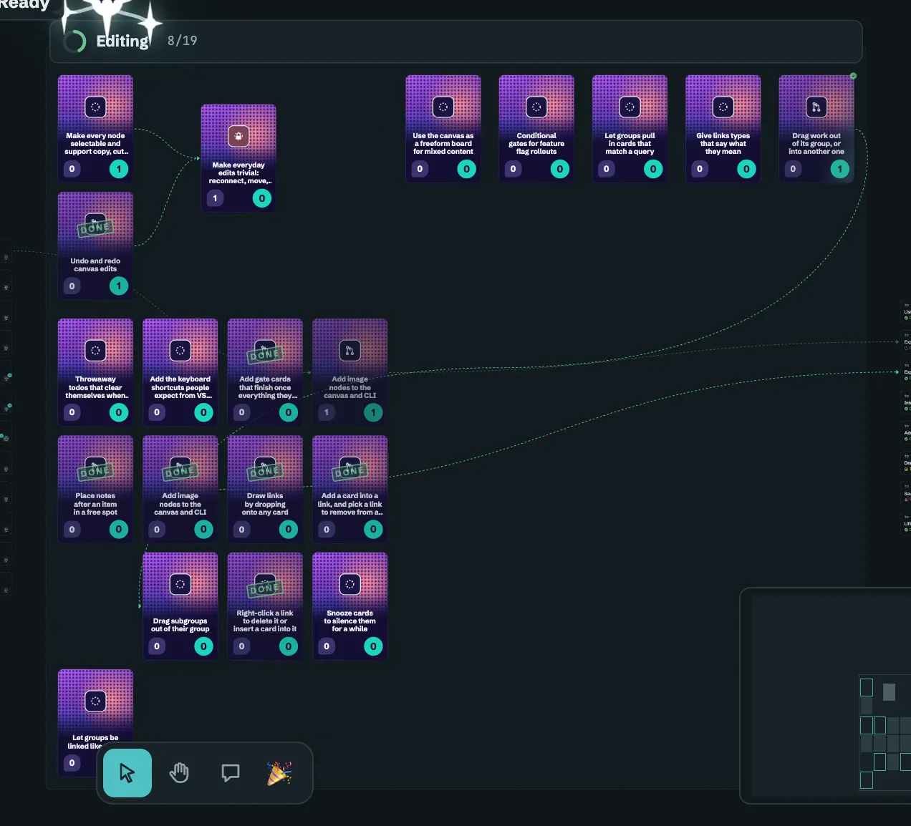

## October 17, 2026: The poster card at every compact zoom

The [poster card in compact form](https://github.com/vocksel/orion/pull/391) merged on October 17. A card that pops up over the canvas used to draw a different design from the compact card under it. Now every compact form of a trading card draws the same poster face. Hovering or selecting a card below the breakpoint shows the poster face at a larger size. Holding Ctrl over a card, the peek shows the poster face at its larger size, with its note on a dark panel underneath.

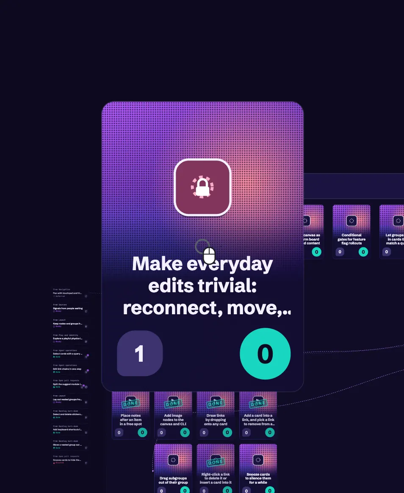
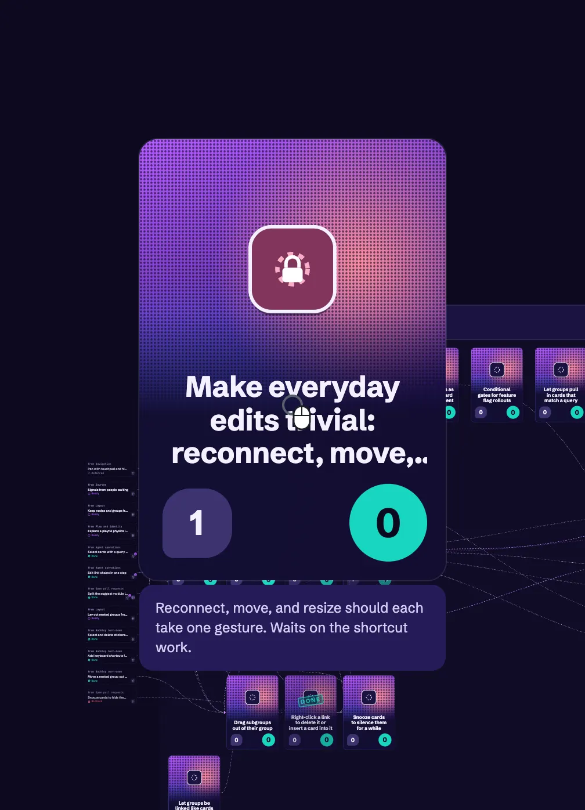

Faded trading cards also stopped showing the canvas through them. The [opaque frame](https://github.com/vocksel/orion/pull/393) was merged. Done, deferred, and dimmed cards used to fade their whole frame, so links showed across the art and title. Now the frame stays solid, and only what is on it fades.

## Rules the cards keep

- Holo and tilt never touch text.
- Status uses shape as well as color, so colorblind palettes carry over.
- Each part has one job. A card never says the same thing twice, and "Your move" appears only where it applies.
- Readable at a glance comes first, as in Legends of Runeterra's card framing. Effects decorate a card without competing with its text.
- Kind owns the silhouette and tint. Status keeps the border, the pill, and the footer chip. Rarity keeps its seal.
